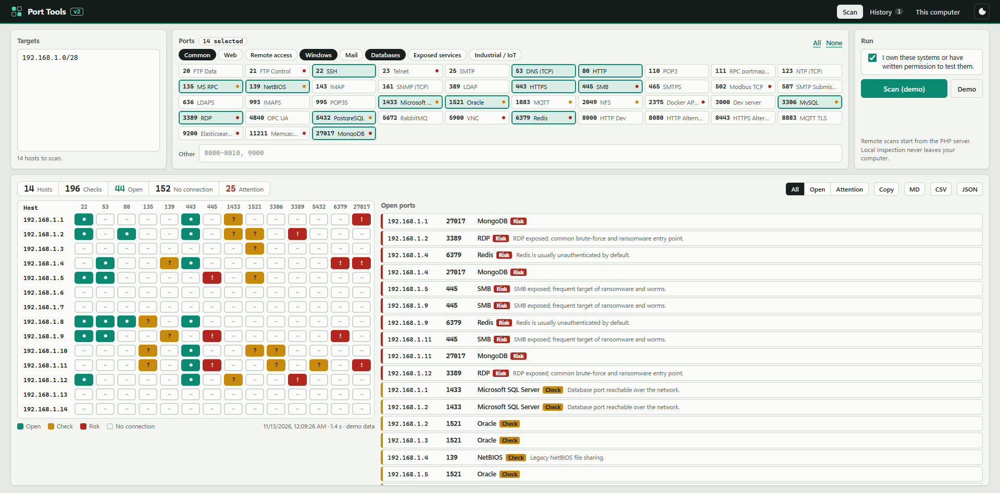
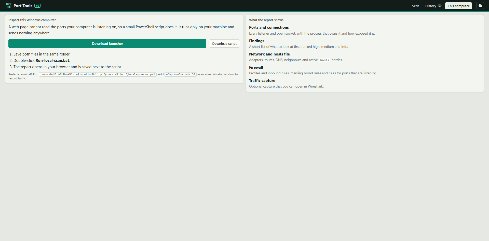
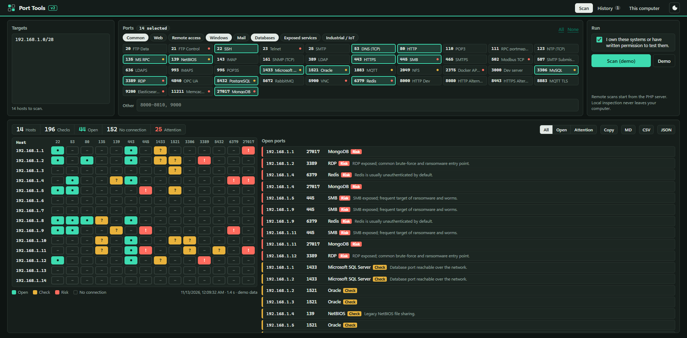
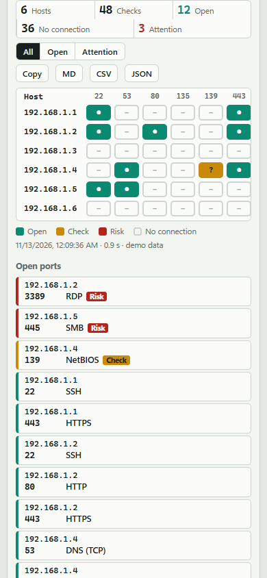
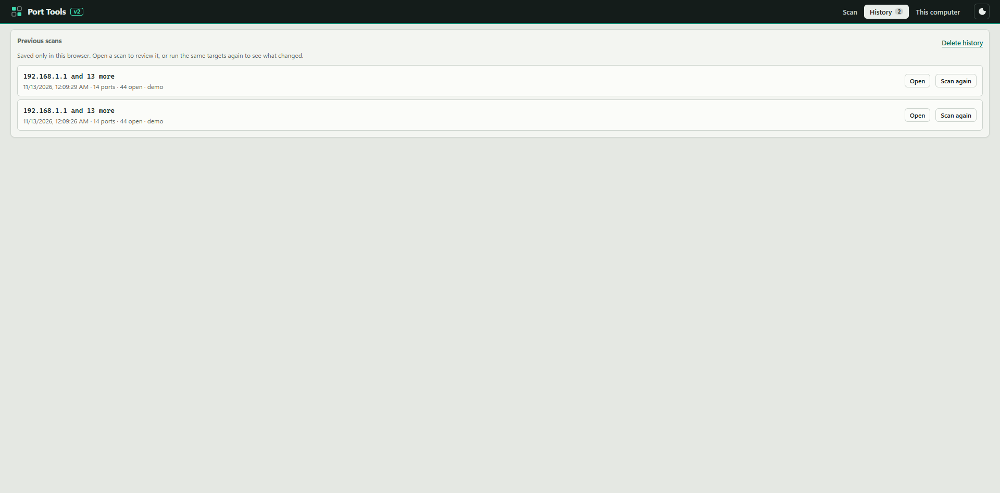

# Port Tools v2

A small toolkit with two independent modes:

1. **Remote scan** (`index.html` + `scan.php`): the browser sends IPv4 targets and TCP ports to a PHP server, which tries a TCP connection to each one and returns a report.
2. **Local computer inspector** (`local-scanner.ps1`): a PowerShell script that collects listening ports, connections, processes, network configuration, hosts file and firewall rules and writes one interactive HTML report. Nothing leaves the machine.

> Only scan systems you own or have explicit permission to test.



*The screenshots use the built-in demo mode, which generates simulated results.*

## What is new in v2

**Remote scan**
- **Ranges and subnets** as targets: `10.0.0.5`, `10.0.0.1-20`, `10.0.0.0/28`, with a live count of hosts.
- **Custom ports and ranges** (`8000-8010, 9000`) next to the presets; 40 known services and 8 presets (new: Mail, Exposed services).
- **Port matrix**: one row per host, one cell per port, filled in live as each host answers. Cells use colour and a symbol (`●` open, `?` worth a look, `!` exposed risk), so they do not rely on colour alone.
- **Attention levels**: open ports such as RDP, SMB, Telnet, Redis or Elasticsearch are flagged with a short explanation.
- **Progress and cancel**: hosts are scanned four at a time with a progress bar; the scan can be stopped without losing finished hosts.
- **History and comparison**: the last 12 scans are kept in the browser. Running the same targets again shows which ports are newly open or no longer open.
- **Export**: copy as text, or download Markdown, CSV or JSON.
- **Demo mode**: when no PHP is available (for example GitHub Pages) the interface still works with simulated data. Add `?demo=1` to force it.
- **One-screen layout**: on a Full HD monitor the whole scan page fits without scrolling the page. A slim 44 px header, a top strip with targets, a compact grid of all ports (visible at once) and the run controls, and the results below using the full width: port matrix beside the list of open ports, each with its own scroll.
- New design with light and dark themes, keyboard navigation, visible focus, reduced-motion support and a layout that works on a phone.

**Server (`scan.php`)**
- Ports of one host are checked in parallel instead of one after another.
- Targets that are never scanned: `0.0.0.0/8`, loopback, link-local (cloud metadata) and multicast addresses.
- Limits and options moved to `config.php`: request size, ports per request, timeout, an `allow_private` switch for public servers and an optional access token (`X-Access-Token` header).
- Each result carries a `risk` level and a `note`.

## Files

```text
/
├── index.html            Web UI (Scan, History, This computer)
├── assets/app.css        Styles, light and dark themes
├── assets/app.js         Front end logic, no dependencies
├── scan.php              Remote scan backend (requires PHP 8.1+)
├── config.php            Limits, timeout, private-range switch, access token
├── local-scanner.ps1     Local inspector: collects data and builds the HTML report
├── Run-local-scan.bat    Double-click launcher for the local inspector
├── docs/screenshots/     Images used in this README
└── .htaccess, .gitattributes, README.md
```

## Remote scan

Requirements: PHP 8.1 or newer. No extensions beyond the default ones.

```powershell
php -S localhost:8000
```

Then open <http://localhost:8000>. On Apache or nginx put the folder behind PHP-FPM; `.htaccess` hides `config.php` and sets security headers on Apache.

GitHub Pages can display the interface but cannot run `scan.php`, so the page falls back to demo mode there.

### Configuration (`config.php`)

| Key | Default | Meaning |
|---|---|---|
| `max_targets_per_request` | 16 | Hosts accepted by one POST |
| `max_total_targets` | 256 | Hosts the UI expands from ranges or subnets in one scan |
| `max_ports` | 64 | Ports per request |
| `timeout` | 1.2 | Seconds to wait per connection |
| `allow_private` | `true` | Set `false` on a public server to refuse 10/8, 172.16/12 and 192.168/16 |
| `access_token` | empty | When set, clients must send it as `X-Access-Token` |

On a server reachable from the internet, set `allow_private` to `false` and set an access token.

### API

```text
GET  scan.php   -> services, presets, risk levels and limits
POST scan.php   -> {"targets": ["10.0.0.5", "10.0.0.0/28"], "ports": [22, 80, "8000-8010"]}
```

Each port result: `port`, `service`, `status` (`open` or `no_connection`), `ms`, `risk` (`none`, `low`, `medium`, `high`) and `note`.

How to read results:

- **Open**: the PHP server completed a TCP connection.
- **No connection**: closed, filtered, unreachable or timed out. On Windows a refused connection also shows up only after the timeout.

## Local inspector



1. In the **This computer** tab, download `Run-local-scan.bat` and `local-scanner.ps1` into one folder (or use the files from this repository).
2. Double-click `Run-local-scan.bat`.
3. The report `local-ports-YYYY-MM-DD_HH-mm-ss.html` opens in your browser and is saved next to the script.

From PowerShell:

```powershell
powershell.exe -NoProfile -ExecutionPolicy Bypass -File .\local-scanner.ps1
```

Optional traffic capture (PowerShell as administrator, not tested in this environment):

```powershell
.\local-scanner.ps1 -CaptureSeconds 30
```

The report contains an overview with prioritised findings, listening ports with likely service, scope and risk, connections, processes, network configuration, the hosts file, firewall rules and the capture status.

Limitations: "likely use" and risk levels are estimates from port number, process name and path. Without administrator rights some paths, command lines and firewall rules are unavailable. The script performs no reverse DNS lookups and no other network requests.

## More screenshots

| Dark theme | Phone | History |
|---|---|---|
|  |  |  |

## Change history

**v2.0.0**
- Rebuilt interface (`assets/app.css`, `assets/app.js`) with port matrix, filters, history with comparison, exports, themes and demo mode.
- `scan.php`: ranges and CIDR, custom ports, parallel connects, risk notes, forbidden address ranges, token and limits in `config.php`.
- Tested: PHP syntax, GET and POST against a real listener (open and closed ports detected, loopback and link-local refused), and the interface in headless Chrome (desktop, dark, phone) with no console errors.

**v1**
1. First local inspector with listening TCP ports.
2. Detailed report with risk levels, connections, processes, network and firewall data.
3. Interactive report with findings, black-and-white design and optional capture with `pktmon`.

## Plan and next steps

- [ ] Test traffic capture from an elevated PowerShell and confirm the `pktmon` options.
- [ ] Run the inspector as administrator and confirm paths and command lines for all processes.
- [ ] Collapse the firewall table by default in the local report.
- [ ] Traffic summary from the capture (top destinations and ports) without Wireshark.
- [ ] UDP checks for a few common services.

## Interpretation

- `127.0.0.1` or `::1`: localhost only.
- `0.0.0.0` or `::`: all interfaces.
- Listening locally does not mean reachable from outside. The firewall may still block it.
